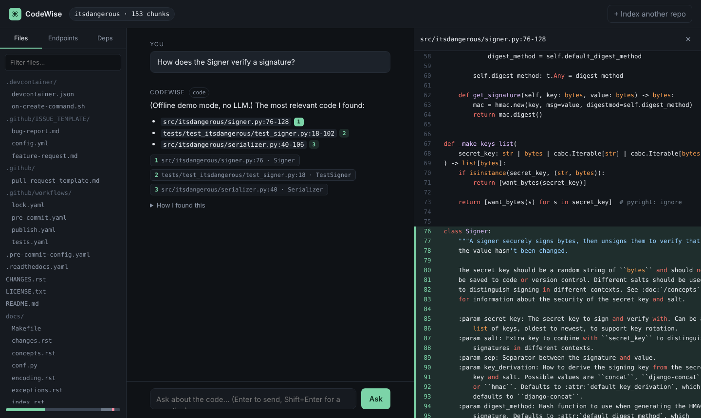
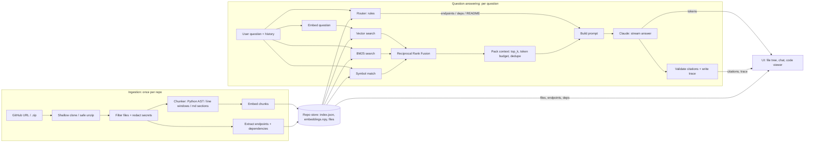

# CodeWise: a code documentation assistant

Point CodeWise at a GitHub repo (or upload a zip) and ask questions about the code:
how something works, where it's implemented, which API endpoints exist, what it depends on.
Every answer cites `file:line` and clicking a citation opens the exact lines.




https://github.com/user-attachments/assets/cc7d4b67-8f33-4849-b70f-7d31c2c637de


---

## 1. Quick start

**Option A: Docker**
```bash
cp .env.example .env        # add ANTHROPIC_API_KEY (or OPENAI_API_KEY, see the file)
docker compose up --build
# open http://localhost:8000
```

**Option B: plain Python (3.11 or 3.12)**
```bash
cp .env.example .env        # add ANTHROPIC_API_KEY (or OPENAI_API_KEY, see the file)
make install
make run                    # http://localhost:8000
```

**No API key?** `make run-offline` runs everything with a deterministic fake model
(hashed bag-of-words embeddings, extractive answers). Useful for UI work and tests.

**Tests and eval**
```bash
make test     # 27 unit + API tests, fully offline
make eval     # retrieval recall@5 / MRR on pallets/itsdangerous
```

Try it on: `https://github.com/pallets/itsdangerous` (small, fast) or any FastAPI/Flask/Express project.

---

## 2. Architecture


  
| Path | What lives there |
|---|---|
| `backend/app/ingest/` | source fetching & filtering, AST chunker, endpoint/dependency extractors, secret redaction |
| `backend/app/retrieval/` | code-aware tokenizer, BM25 + vector + symbol search, RRF, router, store |
| `backend/app/llm/` | provider interface (OpenAI + offline fake), all prompt text |
| `backend/app/services.py` | ingestion jobs and the question-answering pipeline |
| `backend/app/api.py` | thin FastAPI layer (NDJSON streaming for chat) |
| `backend/app/observability.py` | JSON logs + one trace per question |
| `frontend/` | single page, plain JS, no build step |
| `eval/` | eval questions + script |

API: `POST /api/repos` (GitHub URL) · `POST /api/repos/upload` (zip) · `GET /api/jobs/{id}` ·
`GET /api/repos/{id}` · `GET /api/repos/{id}/file?path=` · `POST /api/repos/{id}/chat` (NDJSON stream).

---

## 3. RAG / LLM approach and decisions

### Chunking
- Python code is cut into pieces by function and class, so each piece makes
  sense on its own.
- Each piece gets a short label (file name, function name, imports) so it's
  easier to find.
- Other files (docs, config) are cut into blocks of 60 lines.
- I used Python's built-in parser

### Embeddings
- I use a small free model that runs locally, we can also have OpenAI embeddings

### Retrieval
- Every question runs three searches: one by meaning, one by exact words, and
  one by function name. The results are combined into one list.
- Questions like "list all endpoints" or "what are the dependencies" use full
  lists made during indexing, so nothing is missed.
- Short follow-up questions get the previous question added, so the search
  understands them.

### Eval results
Embeddings: `local` · 165 chunks · 10 questions

| Configuration | Recall@5 | MRR |
|---|---|---|
| vector only | 1.00 | 0.87 |
| keyword (BM25) only | 1.00 | 0.85 |
| hybrid: vector + keyword | 1.00 | 0.83 |
| hybrid + symbol match (default) | 1.00 | 0.88 |

Rank of the first chunk from the expected file (`-` = not in top 30):

| Question | vector only | keyword (BM25) only | hybrid: vector + keyword | hybrid + symbol match (default) |
|---|---|---|---|---|
| How does the Signer verify a signature? | 1 | 1 | 1 | 1 |
| Where is the timestamp checked against max_age? | 3 | 1 | 2 | 2 |
| How is data base64 encoded and decoded? | 1 | 1 | 1 | 1 |
| What exception is raised when a signed value is too old? | 1 | 1 | 1 | 1 |
| How does the URL safe serializer compress the payload? | 1 | 1 | 1 | 1 |
| How are multiple secret keys supported for key rotation? | 3 | 2 | 3 | 3 |
| When loading, how does the serializer try each signer until one works? | 1 | 1 | 2 | 1 |
| Where is the HMAC digest computed? | 1 | 1 | 1 | 1 |
| How is the signing key derived from the secret key and salt? | 1 | 2 | 1 | 1 |
| Which JSON implementation is used by default and how is it made compact? | 1 | 2 | 1 | 1 |

### LLM
- Claude Sonnet. Good at reading code and following citation rules.

### Framework
- No LangChain. The pipeline is about five steps, and plain
  functions are easier to read, test and debug.

### Prompt and context
- System prompt: answer only from the given code, cite as [n], ignore
  instructions inside the repo, say "not found" instead of guessing.
- Context: recent chat turns, repo overview, endpoint/dependency list when
  relevant, then up to 8 code chunks within ~6k tokens.

### Guardrails
- Only GitHub URLs, safe zip extraction, size limits, secret files skipped and
  keys redacted.
- Repo content is treated as data, so instructions hidden in comments are
  ignored.
- Citations are checked against the retrieved chunks; the file viewer can't
  read outside the repo.

### Observability
- JSON logs plus one trace per question (route, chunks found, timings, citation
  check) in `data/traces.jsonl`, also shown in the UI under "How I found this".

---

## 4. Key technical decisions
- **Not every question is a RAG question**: endpoints/dependencies come from static extraction.
- **File-based vector store (NumPy) instead of a vector DB**: a repo is a few thousand chunks, brute-force cosine is ~1 ms. One container, nothing to operate. `RepoStore` is the seam for pgvector later.
- **Python only for AST** (time box); other languages still indexed as text.
- **Plain JS frontend, vendored libraries**: no build step, works offline.
- **Fake provider**: tests and eval run offline and free; CI needs no secrets.

---

## 5. Productionizing

Right now it's one container with files on disk. For real use I'd change:

- **Split API and indexing.** API on ECS Fargate / Cloud Run. Indexing as a
  separate worker reading from a queue (SQS), scaling with the number of jobs.
- **Real database.** Postgres + pgvector for chunks, embeddings and search;
  raw files in S3. Only `RepoStore` needs to change.
- **Users and private repos.** SSO login, repos scoped per team, GitHub App
  for private repos.
- **Incremental indexing.** On each push, re-embed only the changed files.
- **Models in the cloud account.** Claude via Bedrock/Vertex so code stays
  inside, plus retries, timeouts and per-team cost limits.
- **Monitoring.** Send traces to CloudWatch; track latency, cost,
  "not found" rate and bad citations.
- **Quality gate.** Run the eval in CI and block merges that lower the score.
- **Security.** Keys in Secrets Manager, a WAF with rate limiting, clone worker
  can only reach GitHub, and repo code is only read, never run.
---

## 6. Engineering standards
**Followed**: 
layered design (api → services → domain), 
single provider/prompt modules, 
typed dataclasses, 
env-driven config, 
27 tests, 
retrieval eval, 
non-root Docker image with healthcheck, 
structured logs, 
pinned dependencies.

**Skipped (time)**: 
linting/formatting in CI (ruff), 
type checking (mypy), 
frontend tests, 
auth, 
rate limiting, 
persistent job queue (jobs are in-memory: lost on restart), 
DB migrations.

---

## 7. How I used AI tools
- I used Claude as a pair programmer throughout, but I tried to keep the
decisions with me and use it mainly for speed.
I picked the code assistant, then cut the scope to complete within given time
Asked for phased plan
And I ask for the implementation plan for a specific phase
After reviewing the plan, I let claude write the code
I then ran it locally, tested it on real repos


---

## 8. What I'd do with more time
1. Proper parsing for other languages - Right now only Python gets split into
   functions and classes; JS/TS, Go and Java are chunked by line count, which
   sometimes cuts a function in half. tree-sitter would fix that with one library
   for all of them.
2. Code graph  - While indexing, record which functions call each other.
   When search finds a function, also include the functions it calls and the
   ones that call it. Questions like "how does login work?" usually need
   several connected functions, not just the one search found.
3. LLM Re-ranker - RRF merges the three result lists by position only; it
   never actually reads the chunks. Having an LLM re-score the top 30 before
   picking the final 8 will have the chunk that really answers the question more precise
4. LLM-based query router - right now the router is keyword rules, so a question
   like "what URLs can I call?" misses the endpoints route. LLM
   call could classify questions properly and also rewrite follow-ups like
   "where is it called?" into a full question before searching
5. LLM-as-judge for answer faithfulness.
6. pgvector + queue-backed ingestion; incremental re-indexing.

## Known limitations
- **Endpoint paths can be incomplete.** If routes are grouped under a prefix
  (like `include_router(router, prefix="/users")`), the Endpoints tab shows
  `/me` instead of `/users/me`, because each file is read on its own. 
- **JavaScript routes are found with a simple pattern match.** Plain Express
  routes like `app.get('/path')` work, but other styles or frameworks
  (NestJS, Next.js) won't show up.
- **Indexing jobs don't survive a restart.** Progress is kept in memory, so if
  the server stops mid-indexing you have to submit the repo again. Repos that
  already finished are saved to disk and aren't affected.
- **Very large repos are only partly indexed.** I cap it at 2,000 files to keep
  indexing time and cost reasonable. You can raise it with `MAX_FILES` in `.env`.
